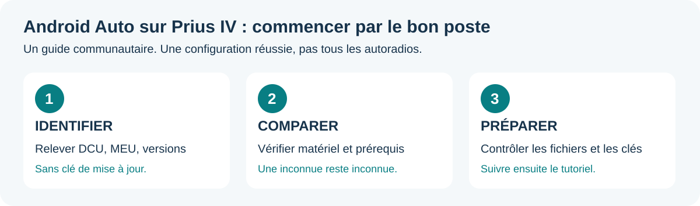
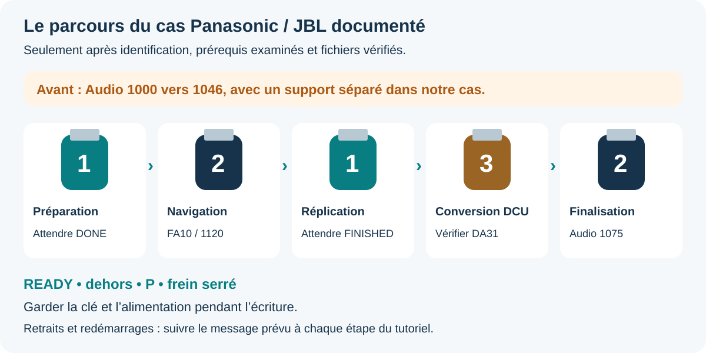

# Prius IV : Android Auto filaire avec le poste Toyota d'origine

**Un retour réel, un guide illustré en français, les liens Toyota et un accompagnement utilisable avec une IA.**

### [Ouvrir le guide interactif →](https://toyrek.github.io/prius4-android-auto-retrofit/)

Identifier son poste, comparer ses références et préparer un message pour son assistant. Sans compte, sans envoi des champs, utilisable aussi hors ligne en ouvrant `guide/index.html` après téléchargement du dépôt.

Le 30 octobre 2026, une Prius IV européenne équipée du Panasonic **86140-47490**, du MEU **86840-06041** et du **JBL** a obtenu Android Auto filaire après adaptation du rétrofit Toyota MM17 vers MM19. Le propriétaire confirme son affichage et son fonctionnement sur l'écran Toyota. Aucun boîtier supplémentaire ni achat de cartes n'a été utilisé.

> **Ce résultat concerne une configuration précise.** Le bulletin Toyota BE-00439T-TME couvre Corolla/RAV4 ; son adaptation à la Prius est communautaire. Une interruption ou un paquet inadapté peut rendre le poste inutilisable. Ne pas appliquer ce parcours à une autre référence sur la seule base de « Prius 4 ».

## Commencer ici

1. **Je découvre :** [le départ en images](docs/00-demarrer.md), puis [les familles de postes et prérequis](docs/01-compatibilite.md).
2. **Je veux de l'aide :** [ma fiche vierge](ai/fiche-vehicule.md) et [le message pour une IA](ai/PROMPT.md). [Mode d'emploi](docs/10-guide-agent-ia.md).
3. **Ma configuration a été examinée :** [téléchargements Toyota](docs/02-telechargements.md), puis [préparation et contrôle des clés](docs/03-preparer-les-cles.md).
4. **Je suis prêt pour le cas décrit :** [installation étape par étape](docs/04-installation.md), puis [contrôles après installation](docs/05-apres-installation.md).

Le formulaire ne donne pas de « feu vert » d'installation. Il repère les informations manquantes, les différences et les conversions déjà commencées. Les variantes USA/Japon, Denso, sans JBL/navigation, avec grand écran ou poste remplacé demandent leur propre étude.

**À emporter :** [tutoriel PDF](downloads/Tutoriel-Prius-IV-Android-Auto.pdf) · [version téléchargeable complète](https://github.com/toyrek/prius4-android-auto-retrofit/releases/latest) · [signaler un retour](https://github.com/toyrek/prius4-android-auto-retrofit/issues/new/choose).

## Configuration et résultat documentés

| Élément | Avant | Après |
|---|---|---|
| DCU | 17TDT2EU-DA01 | **17TDT2EU-DA31** |
| MEU | 17TMT2EU-FA00 | **17TMT2EU-FA10** |
| Audio | 1000, puis préalable 1046 | **1075** |
| Logiciel Navigation | 1512 | **1120** |
| Cartographie navdb | 943 | Non relevée après conversion |
| Android Auto filaire | Non disponible avant | **Lancement confirmé par le propriétaire** |

Panasonic **CV-CS38E2AJ**, JBL, DAB, navigation, lecteur CD. Les références identifient le matériel, pas un numéro de série personnel. Le résultat provient du retour du propriétaire pendant une séance guidée ; il n'est pas une certification constructeur ni un test indépendant de toutes les fonctions.

## Le parcours en un regard

**Audio 1046 préalable → clé 1 → clé 2 → clé 1 → clé 3 → clé 2.**

| Support | Rôle dans ce parcours |
|---|---|
| Audio préalable, séparé | Mettre Audio 1000 à niveau vers 1046 avant le rétrofit |
| Clé 1 | Préparer puis répliquer le système de navigation |
| Clé 2 | Convertir le logiciel MEU, puis finaliser Audio 1075 |
| Clé 3 Europe | Convertir le DCU ; copie complète du profil 42581 sous 47490 pour cette configuration |

Les clés 1 et 3 peuvent agir automatiquement dès leur insertion. Ce tableau ne remplace pas le tutoriel : les messages de fin déterminent quand changer de clé et redémarrer.

## Ce que le dépôt partage

- Documentation réécrite après le succès, avec les incertitudes conservées.
- Liens officiels des quatre archives utilisées et mots de passe des ZIP du bulletin public.
- Empreintes des archives, inventaires des **13 / 21 / 517 fichiers** des clés préparées, contrôle du profil donneur.
- Vérificateur Python **en lecture seule**, sans formatage ni installation.
- Guide web mobile/bureau, schémas originaux et PDF illustré.
- Comparateur local de références, fiche utilisateur, [instructions pour agents](AGENTS.md) et [étapes structurées](ai/procedure.json).
- [Bilan des recherches](docs/06-recherches-et-diagnostic.md), [SmartDeviceLink](docs/07-smartdevicelink.md), [FAQ](docs/08-depannage.md), [sources et crédits](docs/09-sources.md).
- Modèle de retour pour étendre progressivement la [matrice de compatibilité](docs/01-compatibilite.md).

Les firmwares et PDF Toyota restent chez leurs éditeurs ou dans les liens de provenance ; ils ne sont pas redistribués dans ce dépôt. Les journaux bruts, photos avec identifiants, VIN, numéros de série, réseaux Wi-Fi et e-mails personnels ne font pas partie de la publication.

## English summary

Community documentation of **one owner-reported successful wired Android Auto retrofit** on an EU Prius IV, Panasonic DCU 86140-47490 / MEU 86840-06041 / JBL. Starting DA01/FA00, Audio 1000, Navigation 1512, map database 943; final DA31/FA10, Audio 1075, Navigation 1120. Preliminary Audio 1046, then USB sequence 1-2-1-3-2. Complete donor folder 86140-42581 copied as 86140-47490, keeping the original and all file contents. No separate map purchase/update in this case. This is **not a universal Prius procedure or Toyota approval**. Firmware is linked to Toyota, not hosted here. Other hardware and functions require separate verification.

## Contribuer et réutiliser

Voir [CONTRIBUTING.md](CONTRIBUTING.md). Les échecs et résultats partiels sont aussi utiles que les réussites. Documents originaux : **CC BY 4.0** ; outils originaux : **MIT**, voir [LICENSE](LICENSE). Les marques et documents tiers conservent leurs droits respectifs. Projet indépendant de Toyota.

Version documentaire **v1.1.0 - 31 octobre 2026**.
