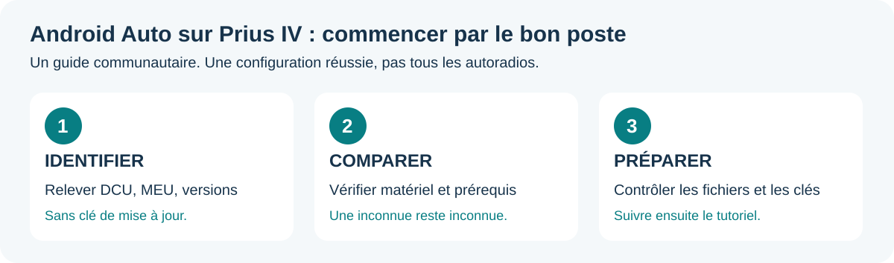
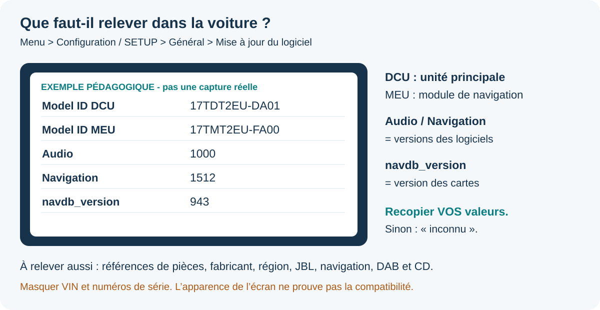
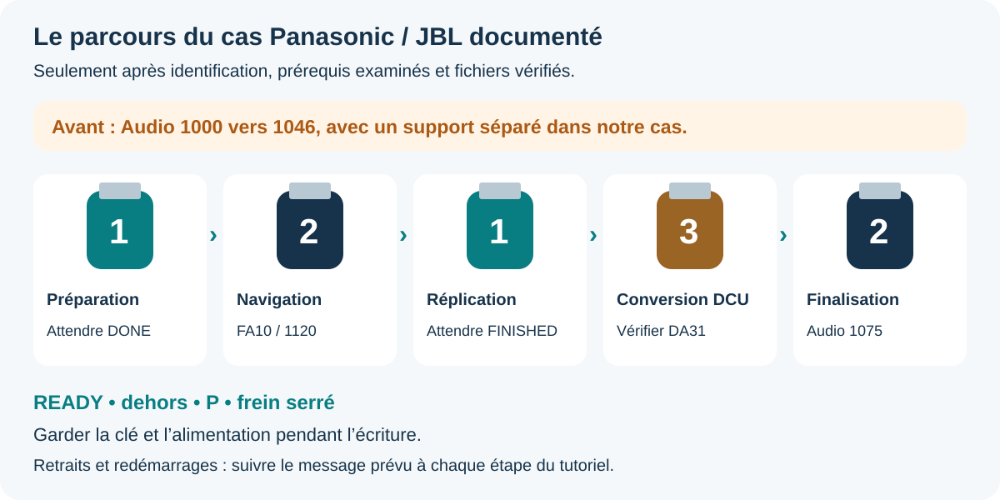

# Commencer simplement

**Ne branchez aucune clé de mise à jour pour identifier votre poste.** On commence avec ce qu'affiche la voiture.

## 1. Photographier les bonnes informations

Voiture à l'arrêt, sans clé de rétrofit : **Menu → Configuration / SETUP → Général → Mise à jour du logiciel**. Les intitulés peuvent varier. Relever les identifiants **DCU** et **MEU**, **Audio**, **Navigation** et **navdb_version**.

Cette illustration est un **schéma**, pas une photo de votre voiture. Les valeurs sont celles de notre cas avant conversion : ne pas les recopier dans votre fiche si elles ne sont pas réellement affichées.

Les références de pièces (ex. 86140-47490) et le fabricant ne sont pas toujours présents sur cette page. S'ils sont déjà connus grâce à un relevé, les noter. Sinon écrire **inconnu** : ne pas démonter le poste ni entrer dans des réglages techniques uniquement pour remplir la fiche. Un professionnel peut aider à les identifier. Masquer les numéros de série et le VIN sur les photos.

## 2. Comparer avant de télécharger

- [Guide interactif](https://toyrek.github.io/prius4-android-auto-retrofit/) : formulaire local, sans compte ni envoi des réponses. Il peut aussi s'ouvrir hors ligne avec `guide/index.html` dans le ZIP.
- [Tableau de compatibilité et recherches](01-compatibilite.md) : lire la ligne qui correspond à votre famille de poste.
- [Fiche à remplir](../ai/fiche-vehicule.md) : utile pour un humain ou un agent IA.

**Même apparence, même année ou même logo JBL ne suffisent pas.** Un résultat « correspond au cas documenté » signifie seulement que les informations saisies correspondent ; il n'autorise pas une installation.

## 3. Se faire accompagner

Copier le [message prêt à donner à une IA](../ai/PROMPT.md), puis fournir votre fiche. L'agent doit vous demander seulement les informations manquantes, expliquer les écarts et donner une seule action à la fois.

Lorsque la configuration et les prérequis ont été examinés, suivre dans l'ordre : [téléchargements](02-telechargements.md), [préparation](03-preparer-les-cles.md), [installation](04-installation.md). Pour notre cas :

Les trois numéros représentent **trois supports distincts réutilisés**, plus le support Audio préalable dans notre cas. Une illustration ne remplace pas les messages de fin du tutoriel.

## Les quatre choses à retenir

1. **Identifier le poste**, pas seulement le modèle de voiture.
2. **FAT32 et fichiers vérifiés** avant d'aller dans la voiture.
3. **READY, dehors, en P**, pendant les écritures.
4. **Attendre le message de fin précis** ; ne pas changer de clé parce qu'un délai est écoulé.
